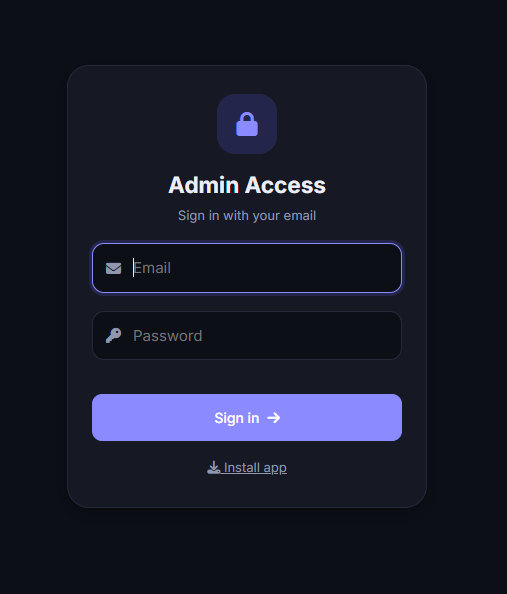
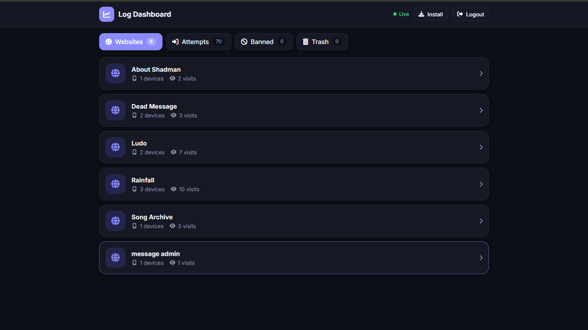
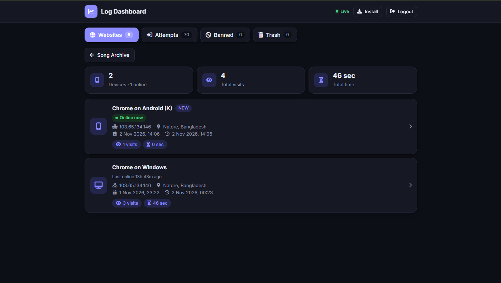
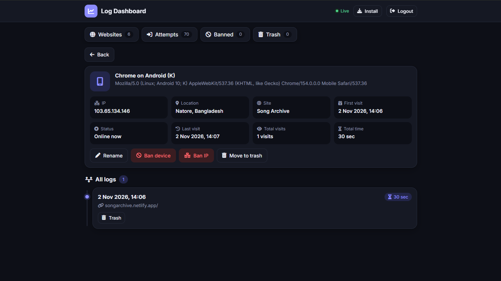
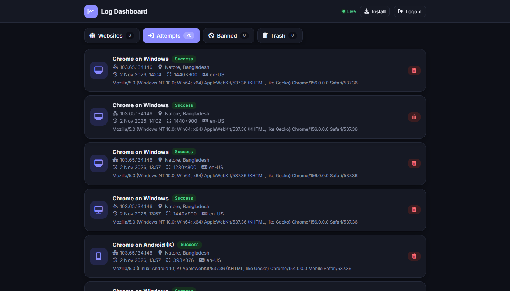
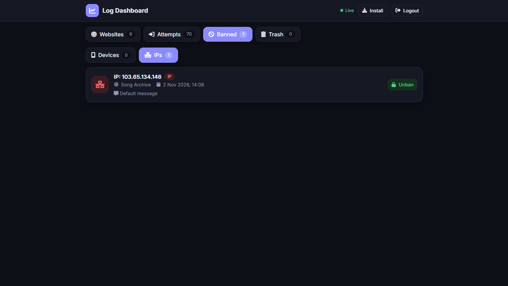
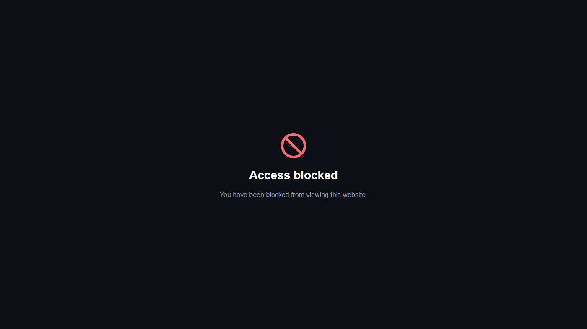

# 📊 self-hosted-visitor-logs (Log Dashboard)

A tiny, self-hosted **visitor log & device tracker** for your own websites.
Add one `<script>` tag to any site, and watch devices, visits, time-on-page, IP/location and live online status in a private, installable (PWA) admin dashboard. You can also **ban a device or an IP** with a custom message.

- 100% static front-end (GitHub Pages / any static host)
- Backend = your own **Firebase Firestore + Firebase Auth** (free Spark plan is enough for small sites)
- No server to run, no build step, no npm
- Dark/light mode, mobile-first, installable as an app

> ⚠️ **You must use your own Firebase project.** Never share or reuse someone else's Firebase config. Follow the setup below.

---

## 📸 Screenshots

| Login | Websites | Devices |
|:---:|:---:|:---:|
|  |  |  |

| Device details | Attempts | Ban dialog |
|:---:|:---:|:---:|
|  |  |  |

<p align="center">
  <b>What a banned visitor sees</b><br><br>
  
</p>

---

## ✨ Features

| Feature | Details |
|---|---|
| Multi-site | One dashboard, many websites (each `data-site` name becomes a group) |
| Device tracking | Browser/OS label, user-agent, first/last seen, visits, total active time |
| Per-visit logs | Page URL, timestamp, time spent (only while tab is visible) |
| Live status | "Online now" / "Last online X ago" |
| IP + location | Via `ipwho.is` (fallback `ipify`) |
| Ban system | Ban by device or by IP, with custom "Access blocked" message, applied live |
| Login protection | 5 wrong passwords → dashboard locked for 24 days (unlock by correct login) |
| Login attempt log | Every attempt with device, IP, location |
| Trash | Soft-delete devices/logs, restore, or delete forever |
| PWA | Installable, offline shell via service worker |

---

## 🗂️ Repository structure

```
.
├── index.html            # Admin dashboard (the PWA)
├── tracker.js            # Script you embed in the websites you want to track
├── sw.js                 # Service worker (dashboard offline shell)
├── manifest.webmanifest  # PWA manifest
├── firestore.rules       # Firestore security rules (edit before deploying!)
├── icons/                # App icons (replace with your own)
│   ├── icon-192.png
│   ├── icon-512.png
│   ├── favicon.ico
│   └── favicon-32.png
├── screenshots/          # Images used in this README
│   ├── login.png
│   ├── sites.png
│   ├── devices.png
│   ├── detail.png
│   ├── attempts.png
│   ├── blocked.png
│   └── blocked2.png
├── LICENSE
├── SECURITY.md
└── README.md
```

> `sw.js` must contain the code **once** only (make sure it isn't pasted twice).

---

## 🚀 Setup (step by step)

### 1) Get the code
Click **Fork** on GitHub (or **Use this template**), then clone it:

```bash
git clone https://github.com/ShadmanShakibSium/self-hosted-visitor-logs.git
cd self-hosted-visitor-logs
```

### 2) Create a Firebase project
1. Go to <https://console.firebase.google.com> → **Add project** (Analytics not needed).
2. **Project settings (⚙️) → General → Your apps → Web (`</>`)** → register an app (no hosting needed).
3. Copy the `firebaseConfig` object. It looks like:

```js
{
  apiKey: "...",
  authDomain: "your-project.firebaseapp.com",
  projectId: "your-project",
  storageBucket: "your-project.firebasestorage.app",
  messagingSenderId: "...",
  appId: "..."
}
```

### 3) Create the database
**Build → Firestore Database → Create database** → pick a location → start in **production mode**.

### 4) Create your ONE admin account
1. **Build → Authentication → Get started → Sign-in method → Email/Password → Enable.**
2. **Users → Add user** → enter your email + a **strong password** (this is your dashboard login).
3. Copy that user's **User UID** (shown in the Users table).
4. 🔒 **Block public sign-up** (very important): **Authentication → Settings → User actions → untick "Enable create (sign-up)"**.
   (Even if you can't find this option, step 5 below still protects you, because the rules only trust your UID.)

### 5) Add the security rules
Open `firestore.rules`, replace the `YOUR_ADMIN_UID` placeholder with the UID from step 4, then paste the whole file into
**Firestore → Rules → Publish**.

The rules only treat **your UID** as admin. Without this, *any* person who can create a Firebase account with your public API key could read your logs.

### 6) Put your config into the code
Replace the Firebase config in **both** files:

- `index.html` → search for `initializeApp({` (inside the `<script type="module">`)
- `tracker.js` → the `CFG` object at the top

### 7) Replace the branding (optional)
- Replace the files inside the `icons/` folder (`icon-192.png`, `icon-512.png`, `favicon.ico`, `favicon-32.png`) with your own. Keep the same file names, or update the paths in `index.html`, `manifest.webmanifest` and the `SHELL` list in `sw.js`.
- Edit `name`, `short_name`, colors in `manifest.webmanifest`.
- Bump `const V="logdash-v7"` in `sw.js` whenever you change cached files, so users get the update.

### 8) Deploy the dashboard on GitHub Pages
1. Push your changes (`git add . && git commit -m "setup" && git push`).
2. Repo → **Settings → Pages** → Source: **Deploy from a branch** → `main` / `/ (root)` → Save.
3. After a minute your dashboard is live at:
   `https://ShadmanShakibSium.github.io/self-hosted-visitor-logs/`
4. In Firebase: **Authentication → Settings → Authorized domains → Add** `ShadmanShakibSium.github.io`.

Open the URL, sign in with the admin email/password from step 4. 🎉

### 9) Track your websites
Paste this before `</body>` on every page you want to track:

```html
<script src="https://ShadmanShakibSium.github.io/self-hosted-visitor-logs/tracker.js" data-site="My Website" defer></script>
```

- `data-site` = the name shown as a group in the dashboard. If empty, the hostname is used.
- You can also copy `tracker.js` into the site itself and use `src="tracker.js"`.

Visit your site once, then refresh the dashboard — the device appears under **Websites → My Website**.

### 10) (Recommended) Restrict your API key
Google Cloud Console → **APIs & Services → Credentials →** your *Browser key* → **Application restrictions → Websites** → add every domain that runs `tracker.js` plus your dashboard domain (e.g. `https://ShadmanShakibSium.github.io/*`).
> The web API key is not a secret by design, but restricting it reduces abuse.

---

## 🧭 Using the dashboard

- **Websites** → pick a site → list of devices → tap a device for full logs.
- **Rename** a device to a friendly alias.
- **Ban device / Ban IP** → the visitor instantly sees an "Access blocked" page with your message. **Unban** from the device page or the **Banned** tab.
- **Trash** → soft-delete; restore or delete forever (banned devices can't be deleted).
- **Attempts** → every login attempt (success, wrong password, locked).
- **Session** auto-expires after inactivity (`SESSION_MIN` in `index.html`, default 2 min).
- **Lock** → 5 wrong passwords lock login for `LOCK_DAYS` (default 24 days). Signing in with the correct credentials on the lock screen unlocks it.

---

## 🛠️ Configuration cheat-sheet

| What | Where |
|---|---|
| Firebase config | `index.html`, `tracker.js` |
| Admin UID | `firestore.rules` |
| Session timeout | `SESSION_MIN` in `index.html` |
| Max failed logins / lock days | `MAXF`, `LOCK_DAYS` in `index.html` **and** the numbers `5` / `24` in `firestore.rules` (keep them identical) |
| "Online" threshold | `ONLINE_MS` in `index.html` |
| Default block message | `DEFAULT_MSG` in `tracker.js` |
| Time-on-page flush interval | `setInterval(flush, 30000)` in `tracker.js` |

---

## 💸 Firebase free-tier note
The Spark plan allows roughly 50k reads / 20k writes per day. `tracker.js` writes on each visit and about every 30 s while the page is open, and the dashboard uses live listeners. Busy sites may exceed the free quota — monitor usage in the Firebase console.

---

## 🔐 Security & limitations (please read)

- **Admin = your UID only.** Keep sign-up disabled and use a strong, unique password.
- Failed-login counting is stored in Firestore and is **publicly writable by design** (needed so the lock works before login). This means someone could deliberately trigger the lock. Your account is then locked until you unlock it on the lock screen with correct credentials.
- Bans are enforced **client-side** by `tracker.js`. A visitor who blocks scripts or the tracker is not blocked. This is *not* a firewall.
- Device IDs live in the visitor's `localStorage`; clearing it creates a "new" device.
- Anyone can create device/log documents (that's how tracking works), so data can be spammed. Treat statistics as indicative, not exact.

## ⚖️ Privacy & legal

This tool collects **IP address, approximate location, user-agent and browsing time** of your visitors. Depending on where you and your visitors live (GDPR, ePrivacy, CCPA, etc.) you may need to:

- publish a **privacy policy** that mentions this tracking,
- ask for **consent** where required,
- honour data-deletion requests (use the *Delete forever* button).

IP/location lookup uses third-party services (`ipwho.is`, `api.ipify.org`) — their terms apply. **You are solely responsible for how you use this software.**

---

## ❓ Troubleshooting

| Problem | Fix |
|---|---|
| `Save failed: permission-denied` | Rules not published, or UID in rules ≠ your account's UID |
| Dashboard empty after tracking | Check browser console on the tracked site; confirm config is identical in `tracker.js`; check API-key referrer restrictions |
| Can't sign in | Email/Password provider enabled? User exists? Not locked? |
| "Locked for 24 days" | Enter the correct email + password on the lock screen — it unlocks automatically |
| Install button doesn't work | Needs HTTPS, valid `manifest.webmanifest`, icons and `sw.js`. Open in Chrome/Safari (not in-app browsers). The Install dialog shows a checklist |
| Icons not showing | Check the `icons/` folder name and the paths in `index.html`, `manifest.webmanifest` and `sw.js` |
| Old version after update | Bump `V` in `sw.js`, hard-refresh |
| IP/location missing | Ad-blockers may block `ipwho.is`; the tracker then continues without it |

---

## 🐞 Found a bug? Need help?

1. **First choice:** open a [GitHub Issue](https://github.com/ShadmanShakibSium/self-hosted-visitor-logs/issues) with
   what you did, what you expected, what happened, and your browser/device. Please **never** paste
   your API keys, UID or private logs.
2. **Security problems** (for example, a way to read the logs without logging in): please **don't**
   open a public issue. Email me privately instead.

## 📬 Contact

| | |
|---|---|
| 📧 Email | [mdshadmanshakibsium@gmail.com](mailto:mdshadmanshakibsium@gmail.com) |
| 🐙 GitHub | [@ShadmanShakibSium](https://github.com/ShadmanShakibSium) |
| 📸 Instagram | [সাদমান সাকিব](https://instagram.com/shadman_shakib_sium) |
| 💬 Discord | [Message me on Discord](https://discord.com/users/1267359105492844545) |

⭐ If this project helped you, please give the repo a star!

---

## 🤝 Contributing
Issues and pull requests are welcome. Please never commit real credentials, UIDs or user data.

## 📄 License
Released under the [MIT License](LICENSE) — free to use, modify and distribute, with no warranty.
